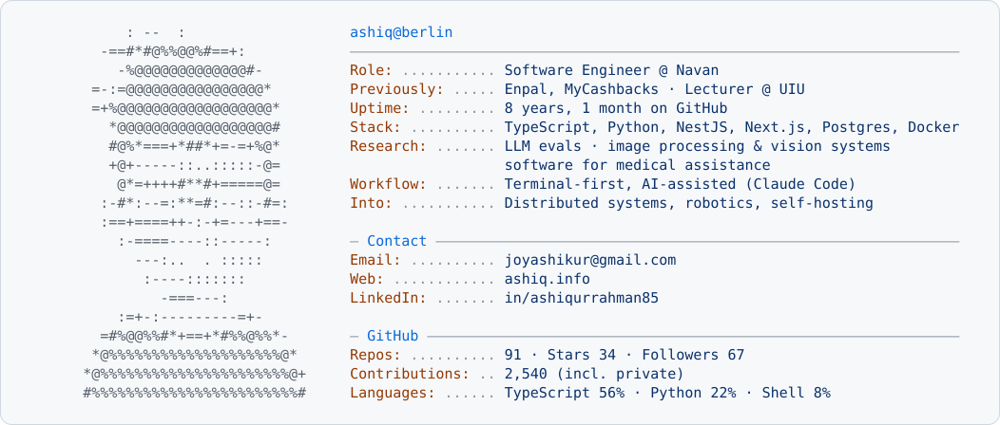

<picture>
  <source media="(prefers-color-scheme: dark)" srcset="card/dark.svg">
  
</picture>

Hey, I'm Ashiq, a software engineer in Berlin. By day I build product at Navan; this profile is where the rest happens: research, experiments, and small tools that make everyday life a little easier (plus the occasional over-engineered weekend project).

[LinkedIn](https://www.linkedin.com/in/ashiqurrahman85/) · [joyashikur@gmail.com](mailto:joyashikur@gmail.com) · [ashiq.info](https://ashiq.info)

### Research

LLM evaluation · image processing & vision systems · software for medical assistance

- **FracAtlas**: bone-fracture X-ray dataset with YOLO-based localization · [code](https://github.com/XLR8-07/FracAtlas)
- **MosquitoFusion**: dataset for real-time mosquito detection · [ICLR paper](https://openreview.net/pdf?id=3s4hFx8pYs) · [code](https://github.com/faiyazabdullah/MosquitoMiner)
- **BanglaDocAtlas**: annotated dataset for Bangla document layout analysis · [IEEE HPEC 2025](https://doi.org/10.1109/HPEC67600.2025.11196300)
- More on [Google Scholar](https://scholar.google.com/citations?user=ujAbMnwAAAAJ&hl=en)
